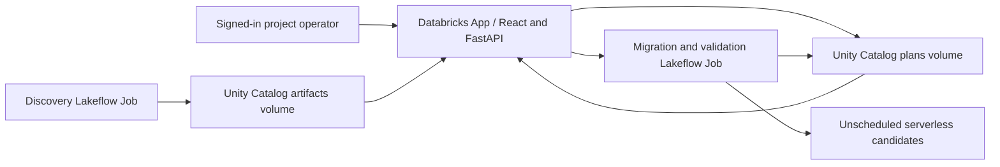

# Strata — Databricks classic-to-serverless migration

Strata is a Databricks App for discovering accessible workloads, reviewing compatibility,
planning individual or wave migrations, creating serverless candidates, and explicitly
requesting validation. This release includes the updated Migration Plans, Validation,
and Activity pages. The compiled interface is included alongside its React/TypeScript source.

## What this bundle deploys

- One Databricks App.
- One read-only discovery/assessment job and one serverless migration/validation executor.
- Dedicated project storage: provisioned separately by the supplied setup command.

The main bundle creates no sample workloads or classic clusters. App compute is configured
as MEDIUM, the size used in the tested Azure deployment. App activity and job execution
incur compute costs. Sample jobs, sample-workload notebooks and sample provisioning are excluded.

## Architecture



Discovery inspects assets visible to the scanner operator; it does not establish
unrestricted workspace coverage. Plans retain inspected source fingerprints and dependency
mappings. The executor verifies the operator, approval, source and runner before mutation.
Requests, progress, per-member results and validation evidence persist in project storage.

## Prerequisites

- A sandbox/internal Databricks workspace supporting Apps, serverless Jobs and Unity Catalog.
- Databricks CLI with Asset Bundle and Apps commands available on PATH; Python 3.10+.
- An existing catalog with managed storage and permission to create a dedicated schema,
  managed volumes, the App and operational jobs. The authenticated deployment operator
  must be allowed to inspect and own the workloads selected for migration.
- Access to install the pinned Python dependencies in `app/requirements.txt`.
- Node.js/npm only if rebuilding the included frontend.

Run commands from this repository root. Substitute your own workspace and profile;
no workspace host, catalog, source job ID or authentication material is bundled.

## Deploy to a new workspace

```powershell
databricks auth login --host https://YOUR_WORKSPACE_HOST --profile strata-target
python -m venv .venv
.venv/Scripts/Activate.ps1
python -m pip install -e ".[dev]"
python -m pip install -r app/requirements.txt
python scripts/setup_agent.py check --profile strata-target --catalog YOUR_CATALOG
python scripts/setup_agent.py provision --profile strata-target --catalog YOUR_CATALOG --schema migration_agent_jr_strata --app-name YOUR_UNIQUE_APP_NAME
python scripts/setup_agent.py validate
python scripts/setup_agent.py deploy
python scripts/agent.py scan --workspace
python scripts/agent.py status
```

On Linux/macOS, activate with `source .venv/bin/activate`. The setup command provisions
only the marked project schema/volumes, then the bundle deploys the App and two jobs.
Keep schema names prefixed `migration_agent_jr_`; preserve the bundle name and `agent`
target because runtime scope guards rely on their paths. Use a fresh checkout for each
workspace/profile; `.local/context.json` is generated locally and is never committed.

Wait until discovery reports SUCCESS, then publish the App source:

```powershell
python scripts/agent.py app-status
# If compute is stopped: python scripts/agent.py app-start
# Wait for active compute before proceeding.
python scripts/agent.py app-deploy
python scripts/agent.py app-status
```

Confirm deployment SUCCEEDED and App RUNNING. Open the URL returned by app-status.
Bundle deployment uploads source; app-deploy publishes an App snapshot. This setup has
multiple steps, including storage provisioning; it is not claimed to be one-command setup.

## Current application workflow

1. Overview and Asset inventory show the latest published discovery snapshot.
2. Compatibility shows readiness, evidence, blockers and recommendations.
3. Migration Plans → Create Migration Plan → Jobs or Notebooks → select workloads.
4. Inspect compute, task/cluster dependencies and compatibility; save a named wave or
   individual plans. Up to 50 items can be selected. A job supports at most ten classic
   tasks, limited to supported Python/SQL workspace notebook tasks.
5. Review and approve a saved migration. Waves create candidates for up to four members
   concurrently, with per-member progress and final state. Partial failure is possible.
6. Successful members appear in Validation. Nothing validates automatically.
7. Start validation explicitly: configuration checks, or output comparison where supported.
8. Activity shows recorded discovery, plan, approval, migration, validation and cleanup events.

**Migration success means a serverless candidate was created.** Originals are preserved;
candidate creation does not execute workloads, prove output equivalence or perform cutover.
Notebook migration creates a copied notebook and a serverless job wrapper. Supported pinned
default-index PyPI requirements are mapped into serverless environment version 4.
Unsupported dependencies, changed sources and unresolved blockers prevent migration.

## Validation

Configuration validation checks the original source, candidate compute, graph/parameters,
copied notebooks, environment mappings and absence of automatic candidate triggers. A passing
configuration check is not an output match.

The current post-migration output comparison supports only the existing pinned synthetic
three-task experiment profile. It needs an existing successful original run, retained notebook
outputs and retained Delta evidence in the marked demo schema. It runs the candidate only;
it does not rerun the original. It compares actual input/output evidence and records checks,
metrics and pass/fail. Failures and missing/changed evidence stop the comparison.

This submission does not include sample-job definitions, sample workload notebooks, retained
runs or data. The profile implementation is retained as part of the app; its required workload
contract is not automatically provisioned. The app does not start classic source workloads
automatically. Arbitrary company output contracts require additional validation profiles.
For a supported source, run it manually before planning and refresh discovery afterwards.

## Verification and scope of evidence

```powershell
python -m pytest tests -q
```

18 focused backend/API checks passed for the packaged release. They cover saved-plan
persistence, approval/identity boundaries, idempotency, source drift, candidate integrity,
explicit validation, output mismatch handling and archival behavior using local fakes.
The deployed Azure app, discovery and migration candidate creation were checked during
development. This release does not claim a successful fresh end-to-end cloud output
comparison through the latest flow or an independently verified clean-workspace installation.
No passing output evidence is shipped or fabricated.

To rebuild after edits:

```powershell
cd frontend
npm ci
cd ..
python scripts/build_app.py
```

Then synchronize with `python scripts/setup_agent.py deploy` and publish again with
`python scripts/agent.py app-deploy`. Source/native-module hashes are checked by the App
launcher. `scripts/verify_release.py` verifies packaged files against RELEASE_MANIFEST.json.

## Challenge coverage and known gaps

See `docs/challenge-coverage.md` for L1–L13. Detection is distinguished from automated fixes.
Approval is tied to the signed-in project operator, not an enterprise workspace-admin group.
Billing/DBU comparison, production cutover, original-job retirement, automatic schedule transfer,
data rollback, universal code/dependency conversion and migration of jobs above ten classic
tasks are not implemented. Waves are not atomic transactions. Legacy reconciliation helpers
are limited to older validated demo records; the new wave flow does not write changes to Git.
Activity is application history, not a complete Databricks audit log.

## Submission

Use a private repository and the exact final commit SHA. The demo video (five minutes
or less) will be supplied separately as an attachment to the submission email. Fill `docs/submission-summary.md` in the email body. This repository contains no
customer data or deployment authentication. Review your own changes and recording before sharing.
The distribution ZIP is an unencrypted source archive for GitHub import; the challenge's
encrypted-ZIP submission option separately requires AES-256 encryption and a password sent
in a separate email. The demonstration video is supplied separately with the email; the repository commit identifies this code submission.

## Third-party software

React, Vite, TypeScript, Lucide React, DM Sans, JetBrains Mono, FastAPI, Uvicorn,
Databricks SDK, PyYAML and pytest are used under their respective upstream licenses.
See `THIRD_PARTY_NOTICES.md`. This package does not assign an open-source license to
your project; choose an appropriate project license before public distribution.
